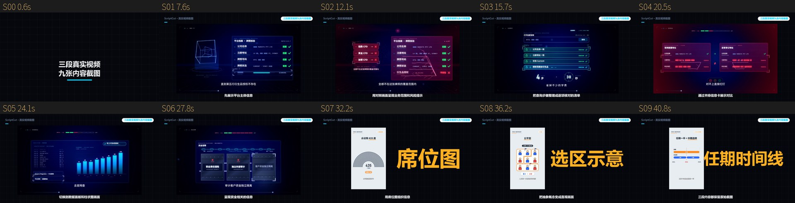

# 示例：三段真实视频截图

从用户提供的三条成片各截取 3 张画面，组成 16:9 的截图解说示例。横屏截图完整展示，竖屏截图放在左侧、右侧配可编辑标题；不裁掉原视频里的图表、字幕和栏目文字。



示例包含 1 个片头、9 个口播镜头、9 张真实截图和 3 个本地文字元素，不需要出图 API。`input/script.txt` 是新写的画面介绍文案，并非原视频的逐字转录；配音使用 edge-tts，实测总时长约 42 秒。画面中的机构、监管信息与时政数据沿用源视频，仅用于展示截图剪辑，不代表已核验其当前状态。

## 跑通示例

仓库已包含 `materials/*.png`，运行时不需要原视频：

```bash
pip install -e ".[all]"
scriptcut check examples/video-screenshots
scriptcut run examples/video-screenshots       # 免费配音 → 时间轴 → 音效配乐 → 可编辑剪映草稿
scriptcut stills examples/video-screenshots    # 可选：Canvas 静帧总览，需要 Chromium
scriptcut render examples/video-screenshots    # 可选：输出 MP4，需要 Chromium
```

剪映草稿预览在 `build/jianying/draft_preview.jpg`；本地文字、截图位置、入场动画与音轨可在剪映中继续编辑。截图中原视频已经包含的文字与图表属于图片内容。

## 截图来源

| 源视频 | 截图时间（秒） | 素材编号 |
|---|---|---|
| `3.识别真正的合规平台（上）改(1)--加音乐--加字幕.mp4` | 22.68、31.76、49.90 | M01–M03 |
| `2.识别真正的合规平台（下）(1)-加音乐-加字幕.mp4` | 17.28、28.81、74.90 | M04–M06 |
| `11.3.mp4`（中期选举） | 51.30、119.69、153.89 | M07–M09 |

完整来源映射见 `materials/sources.json`。仅分发选取的 PNG，原始 MP4 不随仓库上传。持有原视频时可重新提取：

```bash
python examples/video-screenshots/tools/extract_frames.py \
  --upper "/path/to/上篇.mp4" \
  --lower "/path/to/下篇.mp4" \
  --midterms "/path/to/11.3.mp4"
```

提取使用 FFmpeg，保留原始画幅和分辨率，不重绘视频内容。
